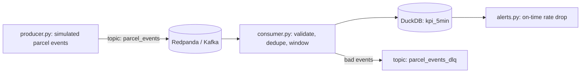

# Kafka Streaming Pipeline (scaffold)

> **Status: scaffold.** Structure and interfaces are in place; the steps in the checklist below are still to do.

**Gap it closes:** streaming and event-driven data (Kafka, near-real-time aggregation). Asked for by Royal Mail, Spotify, Zendesk and PlayStation.

## Goal

Stream simulated parcel-tracking events through Kafka (Redpanda locally), compute rolling delivery KPIs in
tumbling windows, land them in DuckDB, and alert when on-time rate drops in any depot.



## Checklist

- [ ] `docker compose up -d` starts a single-node Redpanda broker (compose file provided)
- [ ] `stream/schemas.py`: event schema and validation (status, depot, timestamps)
- [ ] `stream/producer.py`: emit events with realistic late and duplicate events
- [ ] `stream/consumer.py`: idempotent consumption (dedupe on `event_id`), 5-minute tumbling windows, dead-letter topic
- [ ] `stream/sink.py`: upsert window results into DuckDB
- [ ] `stream/alerts.py`: flag depots whose on-time rate falls more than 10 points below their 7-day baseline
- [ ] Tests for validation and windowing (pure functions, no broker needed)
- [ ] README: results table, design trade-offs (at-least-once vs exactly-once, late data handling)

## Run (once built)

```bash
docker compose up -d
pip install -r requirements.txt
python -m stream.producer &
python -m stream.consumer
```
