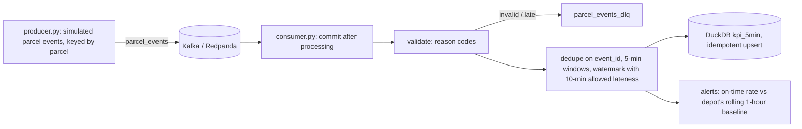

# Kafka Streaming Pipeline

[](https://github.com/Saigwe/kafka-streaming-pipeline/actions/workflows/ci.yml)
 

Streams parcel-tracking events through Kafka, computes on-time delivery KPIs per depot in 5-minute tumbling windows, writes them to DuckDB, and alerts when a depot drops well below its own recent baseline. It handles the problems real streams have: duplicate redeliveries, malformed messages and late data.



## Result of the offline run

The simulator produces 6 hours of events across 4 depots (about 30,000 messages) with 3% duplicate redeliveries, 1% late arrivals, 0.5% malformed messages, and an **incident at OPO from 11:00 to 12:30** (more failed attempts and missed promise times).

| Outcome | Messages |
|---|---|
| Counted in a window | 24,616 |
| Duplicates ignored | 868 |
| Late (beyond watermark), sent to DLQ | 295 |
| Invalid, sent to DLQ | 128 |
| Non-outcome statuses (in transit etc.) | 3,889 |

**All 18 alerts fired for OPO, between 11:00 and 12:25: exactly the incident window, with no false alarms at the other three depots.** See [`output/run_summary.md`](output/run_summary.md).

## Design choices

- **Broker-agnostic core.** Validation, deduplication, windowing, sink and alerting live in `stream/pipeline.py` and take raw messages. The Kafka consumer and the offline simulator both feed the same `Processor`, so all logic is unit-tested without a broker.
- **At-least-once delivery, idempotent processing.** Offsets are committed only after processing. Redeliveries are dropped by `event_id`, and the DuckDB sink uses `insert or replace`, so replays don't double count.
- **Event time, not arrival time.** Windows use the event timestamp. A watermark (latest event time minus 10 minutes) decides when a window is final; anything older goes to the dead-letter topic as `late` instead of silently changing published numbers.
- **Alerting tuned against noise.** Thin windows (under 40 outcomes) are skipped, the threshold is 12 points below the depot's own rolling baseline, and alerting windows don't drag the baseline down. An earlier version with a 10-point threshold on smaller windows fired false alarms at healthy depots, which is why these settings exist.
- **Keyed by parcel**, so all events for one parcel land on the same partition, in order.

## Run it

Offline (no broker):

```bash
pip install -r requirements.txt
python -m stream.simulate      # writes output/run_summary.md and output/kpis.duckdb
pytest
```

With Kafka (needs Docker):

```bash
docker compose up -d           # single-node Redpanda on localhost:9092
python -m stream.consumer      # in one terminal
python -m stream.producer      # in another
```

The Kafka wrappers (`producer.py`, `consumer.py`) are thin and have only been run against the design, not a live broker. CI covers the processing core.

## Walkthrough

- [ ] 3-minute Loom walkthrough ([script ready](docs/walkthrough.md))

## Stack

Kafka (Redpanda), confluent-kafka, Python, DuckDB, pytest.
